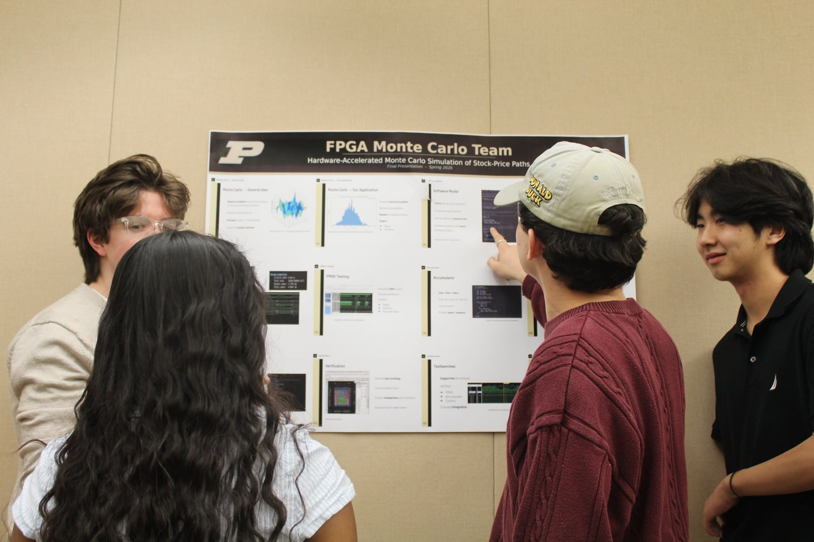
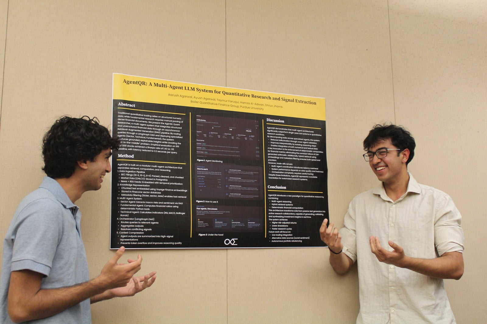

Projects:
- Finmath Binding Library
- FPGA Options Pricing
- Order Book Modeling
- GTO Poker Solver
- GPU Acceleration
- Predictions Market Microstructure
- Live Trading Simulator
- Agentic Quant Researcher

